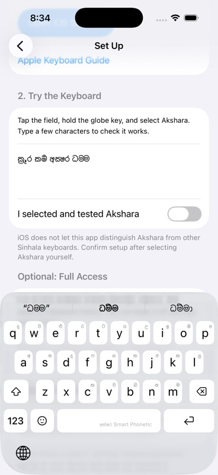

# Smart Phonetic v2

The Swift converter and sound lexicon port Akshara Android PR #7, pinned to
`ba85be39bc801c6c6ae544feae067fad29e1ede3`:
https://github.com/AksharaOrg/akshara-android/pull/7

The linguistic reference is Srilal Siriwardhana's MIT-licensed Sinhala Phonetic
Orthography:
https://github.com/SrilalS/Sinhala-Phonetic-Orthography

The complete MIT notice ships in `Akshara/SinhalaOrthography-LICENSE.txt` and the
app's Open Source Notices. Preserve it when updating the port. The reference
has since added a fifth `retroflex_d` option; this release deliberately implements
the four options in PR #7 and retains the complete classic converter.

## Behavior

V2 defaults on within Smart Phonetic. Existing selected layouts remain unchanged.
Settings → Keyboard Settings → Smart Phonetic Spelling exposes the classic switch
and four options (all off by default): rakaransaya + u, joined repaya, classical
conjuncts and archaic letters.

The pure converter uses a longest-match tokenizer and a state machine. It renders
the word while typing; dictionary disambiguation runs separately on a worker.
Space chooses only whole-word sound matches, preserving explicit spellings of
known words and explicit independent vowel letters. Prefix completions are
available through suggestion taps. Unknown words keep the converter spelling.

Space disambiguation is independent of the opt-in typo-autocorrect and
Space Accepts Suggestion settings and works with the suggestions rail hidden.
The sound index is built only for v2, on a worker, and is warmed when that layout
appears even with the rail hidden. Other layouts retain their existing model preparation.
It respects protected/rejected words, field traits, document identity, selection,
caret context and the current source/configuration. If a result is not ready,
Space keeps the live spelling; the main thread never waits for dictionary loading.
Immediate Backspace uses the existing correction undo path.

Dictionary and learned candidates are restyled for rakaransaya + u, joined repaya
and classical conjuncts. Their underlying dictionary counts are retained for ranking.
Archaic mode changes the converter's supported letters and routes + / ~ into
composition rather than treating them as delimiters.

The live rewrite window retains the full Latin word in committed segments. Every
v2 rendering uses that full source, then removes the committed rendered prefix.
If a later token changes committed glyphs, the word is reopened. A suffix whose
standalone spelling differs from its contextual live rendering is not split.

## Models

The original prediction TSVs had zero ZWJ. The repair script restores mandatory
yansaya/rakaransaya joins using the reference normalize(), without changing row
counts or numeric frequencies. It leaves a source that already contains joins
as written, since morphology can intentionally keep some clusters apart.

The frequency, bigram and trigram models were repaired (103, 68,619 and 686 ZWJ
respectively); the sentence-start seed list needed no changes. Both source-build
scripts now preserve joiners in tokens and invoke the repair. Bigram byte offsets
must be rebuilt after any TSV change:

```sh
python3 Scripts/normalize_sinhala_prediction_models.py AksharaKeyboard/Resources
swift Scripts/build_prediction_sidecars.swift AksharaKeyboard/Resources
```

Joined model and learned words are accepted by runtime validators. The existing
verified typo-autocorrect lexicon remains a separate resource.

## Validation

```sh
zsh Scripts/test_smart_phonetic_v2.sh
zsh Scripts/test_sinhala_predictions.sh
zsh Scripts/benchmark_keyboard_runtime.sh
python3 Scripts/normalize_sinhala_prediction_models.py AksharaKeyboard/Resources --check
swift Scripts/build_prediction_sidecars.swift AksharaKeyboard/Resources --check
```

The Android fixture and matching frequency dictionary are pinned in
`Scripts/Fixtures`; they are test-only resources and are not bundled with the app.
The dictionary fixture has the same UoM frequency-list provenance described in
the production resource attribution. Do not compare candidate golden rows with
a different dictionary.

The fixture has 96,919 rows: T 26,840; O 41,948; K 4,000; N 117; C 3,214;
R 16,000; D 4,800. Checks compare Unicode scalars, including ZWJ, rather than
Swift's canonically equivalent String equality. It has zero mismatches.

Additional tests use the production iOS dictionary for whole-word choices,
all 16 option combinations, 1,872 incremental rendering checks, cancellation,
source/configuration cache separation, joiner validation, preference defaults,
classic fallback, and learned-word restyling. The existing prediction, editing,
autocorrect, English, persistence, sidecar and composition-hygiene tests pass.

Simulator checks on the existing iPhone 17 Pro / iOS 26.5, using the actual
Akshara key controls in the Setup editor:

- honda → හොන්ද; Space → හොඳ; Backspace → හොන්ද.
- kazda + Space stays කඳ.
- With Suggestions and typo Autocorrect both off, honda + Space still commits හොඳ.
- With spelling options enabled, Space retains ක්‍රූර, කර්‍ම and අක්‍ෂර.
- With archaic enabled, dham+ma forms ධම ZWJ ් ම through the symbols layer.
- The settings page starts with v2 on and all four options off.



