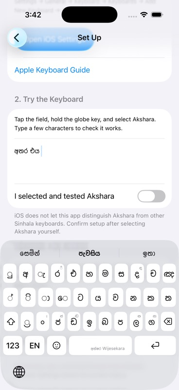

# Sinhala next-word predictions

Verified on 2026-10-12 in the existing iPhone 17 Pro simulator, iOS 26.5, Akshara Debug.

## Cause and change

The Sinhala controller returned early for every empty composing prefix. This suppressed the empty-prefix request needed after Space or a candidate selection, even though the bigram/trigram provider returned valid contextual followers. The frequency and bigram resources were healthy; the indexed and fallback provider tests both passed.

The controller now suppresses requests only when both the composing word and preceding-word context are empty. Direct Wijesekara and phonetic boundary commits seed context with the completed word before requesting its followers. Candidate taps already seed context and now reach ranking. A normal direct commit requests predictions after inserting its separator; the redundant phonetic refresh was removed. Blank fields continue to suppress sentence openers and previous-field context.

## Validation

- `Scripts/test_sinhala_predictions.sh` passed, including new empty-field/request eligibility and contextual suggestion-chain regressions, indexed/fallback bigram validation, cancellation, and the 20,473-prefix completion-priority audit.
- Simulator build and run succeeded.
- Wijesekara key taps: `අතර` + Space produced a centre suggestion `එය` with alternatives `ඔහු` and `ඔවුන්`. Tapping `එය` inserted `අතර එය ` and refreshed the rail to `පැවසිය`, `සෙමින්`, and `ඉතා`.
- Smart Phonetic key taps: `athara` rendered `අතර`; Space committed it and displayed the same contextual next-word suggestions.
- Cleared the disposable editor, restored the original Wijesekara layout, and reopened the empty editor. The rail remained blank, with no stale suggestions.
- No commits or pushes.

