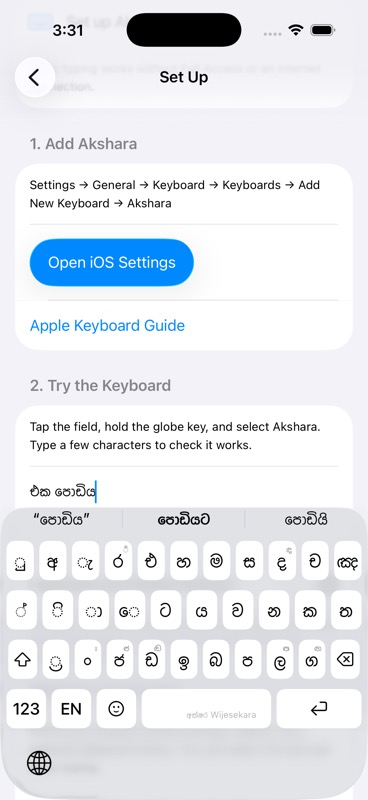

# Sinhala completion priority

Verified on 2026-10-12 using the existing iPhone 17 Pro simulator (iOS 26.5), Akshara Debug, Wijesekara layout and Suggestions enabled.

## Cause and change

For `එක පොඩි`, the frequency/context provider ranks `පොඩියට` first. The two-grapheme input is a verified spelling and receives no spelling suggestions. Adding `ය` makes `පොඩිය` a three-grapheme input absent from the compact verified-spelling lexicon. The spelling service then suggests `වැඩිය`, `ගෙඩිය`, and `කොඩිය` as one-edit alternatives. The controller previously inserted all of these ahead of the still-correct `පොඩියට` completion. Separately, a highly ranked learned one-edit match could evict completions from the provider's bounded results.

Both stages now put Unicode scalar prefix matches first. Existing context and frequency order is retained within the completion group. Spelling alternatives follow completions and remain available when there are no completions. This applies to all Sinhala prefixes, including vowel signs and partial conjuncts. Smart Phonetic V2 keeps its separate exact-sound-match priority. No dictionary entries were changed for this fix; `වැඩිය` itself is a legitimate word.

## Validation

- `Scripts/test_sinhala_predictions.sh` passed. It audits every proper grapheme prefix of at least three graphemes in the bundled frequency corpus: 20,473 unique prefixes, including 9,556 with non-prefix spelling suggestions. None displace the first completion.
- Regression coverage includes the reported phrase, alternate preceding-word contexts, a very high learned score for `වැඩිය`, result limits 1/2/3/24, deduplication, scalar prefixes, partial conjuncts, and the existing typo/joiner correction fallbacks.
- `Scripts/test_smart_phonetic_v2.sh` passed: 96,919 golden rows, all 16 spelling option combinations, 1,872 incremental checks and production choice/cancellation checks.
- Final simulator build succeeded. Typed `එක පොඩි` with actual Wijesekara key taps, then added `ය`: `පොඩියට` stayed in the centre slot, followed by `පොඩියි`. Deleting and re-entering `ය` retained the completion. Selecting it produced `එක පොඩියට `, preserving the preceding word.
- The disposable setup field was cleared afterwards. No keyboard preferences were changed and nothing was committed or pushed.

