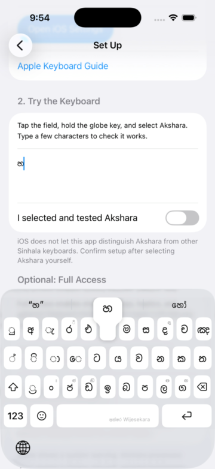

# Top-row key previews

12 October 2026: built and installed on the existing iPhone 17 Pro simulator
(iOS 26.5). With Suggestions and Character Preview enabled, holding the top-row
Wijesekara හ key shows the complete callout inside the suggestion band. It
disappears on release. The screenshot was extracted from the simulator recording.

The compact rail provides less clearance than the former fixed 55-point
requirement. Previews now fit that clearance when the rail is visible. The
existing full-height requirement remains when the rail is hidden.

